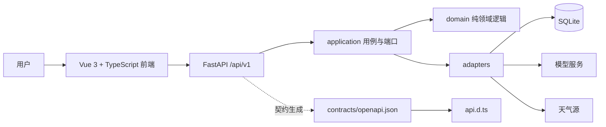

# KairosTide Demo · 无计时器的自然场景时钟

> 一套由真实时间、地点、天气与日程共同驱动的原创交互系统：让时间可以被感知，但不被盯着。


## 摘要

KairosTide 是一个弱化钟表的自然场景 Demo。首页不显示钟点、时间轴、下一事件或剩余分钟数，而是用太阳、天空、月亮、云、水面与物候变化表达时间流动；用户长按画面才查看到真实时间，用自然语言向助手询问日程，事件进行中则由一只当季当时的生灵出现在池塘上作为提醒。

本项目只借鉴了开源项目「旅行天气时钟-Esp32C3 2.0」的少量思路——桌面天气时钟的场景方向、天气数据入画、开源可复刻的精神；**没有沿用其硬件、结构或固件**。产品定义、交互方式、对话助手、场景渲染与工程架构均为本项目独立二次开发与原创创作。借鉴与原创边界见 [docs/KAIROSTIDE.md](docs/KAIROSTIDE.md)。

---

## 一、背景与问题

传统时钟与日程工具普遍存在三个问题：

| 问题 | 表现 | KairosTide 的回应 |
| --- | --- | --- |
| 时间焦虑 | 屏幕常驻钟点、倒计时与剩余分钟 | 时间不常驻，按需浮现 |
| 提醒打断 | 弹窗、铃声强行抢占注意力 | 提醒化入场景，成为一只生灵 |
| 录入负担 | 日程需手工填写字段、选择时间 | 自然语言描述，助手生成待确认草稿 |

被借鉴的天气时钟把天气、日期和温度放上桌面屏幕，验证了“真实数据可以构成桌面氛围”，但其信息仍以读数方式常驻显示。KairosTide 在此基础上重新定义了交互目标：**时间从“被读取的数字”变成“被感知的环境”**。

## 二、设计目标

| 目标 | 落地设计 |
| --- | --- |
| 氛围化时间 | 田园四时场景由真实时间、地点、天气驱动 |
| 低打扰提醒 | 长按查时；事件进行中生灵出现，代替圆环与红点 |
| 可信助手 | 草稿确认制、依据逐字核对、不猜不编造 |
| 真实世界数据 | 天文、气象、农历、物候统一进入场景 |
| 隐私可控 | 图片仅当轮使用不落库，密钥只在服务端，定位可拒绝 |

## 三、核心演示亮点

| 亮点 | 演示动作 | 预期现象 |
| --- | --- | --- |
| 长按查时 | 在首页按住画面约 600ms | 按压点附近显示真实时间，约 3 秒后淡出；松手后画面恢复无钟点状态 |
| 生灵提醒 | 触发一个进行中的刚性事件 | 池塘出现属于当前季节、时段与天气的动物；点击展开事件卡 |
| 对话建日程 | 输入“下周四早上八点提醒我交实验报告” | 助手返回待确认草稿，不直接写入；确认后才保存 |
| 不猜与依据核对 | 只说开始时间、要求不确定的标题 | 助手追问缺失字段；草稿引用用户原话，服务端逐字校验 |
| 图片导入 | 上传课表或通知截图 | 助手识别出多条日程，生成可勾选草稿；图片不进数据库 |
| 场景真实性 | 切换时间 / 地点 / 天气 | 星空、月相、水面、云影与生物随之变化 |
| 隐私边界 | 拒绝定位、查看设置 | 系统按时区估算继续运行；不要求二次授权，密钥不下发前端 |

## 四、演示流程（建议 5 分钟）

1. **首页场景**：打开首页，展示田园四时画面。说明画面由真实时间、地点与天气驱动，屏幕上没有钟点与倒计时。
2. **长按查时**：按住画面约 600ms，展示时间浮现与淡出。强调“想看时才有”。
3. **事件提醒**：触发一个刚性事件，等待池塘出现当季生灵；点击生灵展开事件卡，演示“例外 / 冲突选择 / 结束”流程。
4. **对话生成草稿**：向助手说一句带相对日期的提醒，展示草稿卡片、依据引用与确认按钮；先不确认，再问“这条保存了吗”，助手应如实回答未确认。
5. **柔性任务与图片导入**：输入“抽空背单词”生成柔性任务；上传一张课表截图，展示多条可勾选草稿。
6. **真实世界数据**：展示夜间星空、月相与农历文案，说明数据来自公开历表与天文模型，而非随机动画。
7. **边界说明**：最后展示本页第六节，明确借鉴范围与原创归属。

## 五、技术方案

### 5.1 系统架构



依赖方向固定为 `api → application → domain`。系统内部分离三种时钟：`RealClock`（真实世界时间）、`SceneClock`（场景时间）、`ScheduleClock`（日程时间），避免动画时间与日程时间互相污染。

### 5.2 关键实现

- **草稿不可变**：内容带摘要校验，只有状态会变；确认时版本不符即拒绝。
- **白名单工具与拒绝逻辑**：助手只能调用限定工具；否定或假设句不触发写入，服务端独立判断。
- **依据逐字核对**：草稿必须引用原话连续片段，防止模型编造用户意图。
- **天文与物候模型**：真实亮星表、月相与月距、流星雨历表、农历节气；锦鲤体轴行波、萤火虫脉冲耦合同步、树木悬臂梁摆动与冠层光斑均按可查证模型实现。
- **门禁体系**：`scripts/check.py all` 统一检查文档链接、分层依赖、单文件行数、mypy strict、ruff、pytest、vue-tsc、vitest 与构建；契约改动后需重新生成前端类型。

## 六、借鉴关系与原创边界

| 借鉴自「旅行天气时钟」 | KairosTide 的原创实现 |
| --- | --- |
| 桌面天气时钟的场景方向 | 无计时器自然场景与长按查时 |
| 天气 / 日期 / 温度进入画面 | 天文、气象、物候统一驱动画面 |
| 开源、低成本、可复刻精神 | 对话助手草稿制、柔性任务、图片导入与工程门禁 |

- 被借鉴项目：[旅行天气时钟-Esp32C3 2.0](https://oshwhub.com/eda_pnhleoqpu/esp32c3_-zhang-tiao-ping-you-hu-ji_copy_copy_copy_copy_copy)，作者 eda_pnhleoqpu，协议 GPL 3.0，知识产权归原作者；平台声明仅限学习交流研究，不得商用。
- KairosTide 的产品定义、交互、助手、场景渲染与工程实现归本项目作者原创。我们不宣称原作者的硬件、结构与固件为原创，也不把 KairosTide 描述为该项目固件移植。
- 完整清单与归属表见 [docs/KAIROSTIDE.md](docs/KAIROSTIDE.md)，资料出处见 [docs/SOURCES.md](docs/SOURCES.md)。

## 七、完成度与验证

| 部分 | 状态 |
| --- | :---: |
| 田园场景、长按查时、刚性事件全流程、天气代理 | ✅ 完成 |
| 生灵提醒替代圆环标记 | ✅ 完成 |
| 助手对话、查询与新建草稿 | ✅ 完成 |
| 修改 / 删除 / 请假草稿、地点页 | ✅ 完成 |
| 柔性任务领域、仓储与助手工具 | ✅ 完成 |
| 图片导入后端与批量草稿 | ✅ 完成 |
| 图片导入前端与流式回答 | ✅ 完成 |

后端 pytest + mypy strict + ruff、前端 vitest + vue-tsc、架构与契约门禁均已通过，并进行过真实模型与浏览器实测。界面效果以浏览器实测为准。

## 八、如何运行 Demo

```bash
# macOS 一键方式
bash scripts/setup.sh
bash scripts/start.sh          # 加 --demo 写入演示事件
```

手动方式：在 `services/api` 执行 `uv sync` 与 `uv run kairos-api`（监听 127.0.0.1:8000），在 `apps/web` 执行 `npm install` 与 `npm run dev`。助手功能需要配置 `MIMO_API_KEY`；未配置时其余功能照常运行。完整配置项见 KairosTide 项目 README。

## 九、附录：被借鉴项目硬件资料

本仓库保留被借鉴项目的公开硬件资料，便于查阅与对照；这些参数仅作资料记录，KairosTide 未沿用该硬件设计。

| 项目 | 参数 |
| --- | --- |
| 主控 | ESP32-C3 |
| 屏幕 | 1.9 寸 TFT，320×170，ST7789，4-SPI，10P |
| 发声 / 测温 | 3 个蜂鸣器 / 热敏电阻 |
| 板间连接 | 两块 PCB，14P / 0.5 mm FPC |
| 结构 / 协议 | 3D 打印外壳 + M2 自攻螺丝 / GPL 3.0 |

详细硬件说明、BOM、接口与装配注意事项见 [docs/HARDWARE.md](docs/HARDWARE.md)、[docs/BOM.md](docs/BOM.md)、[docs/PINOUT.md](docs/PINOUT.md)、[docs/ASSEMBLY.md](docs/ASSEMBLY.md)。
