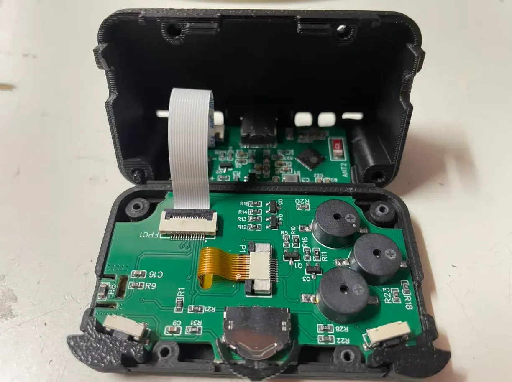
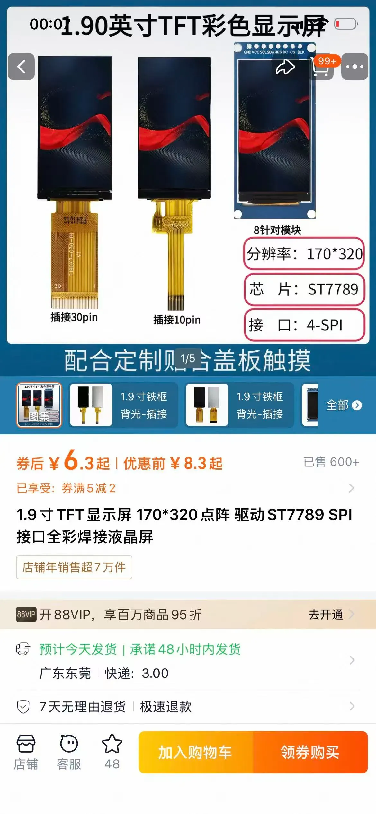
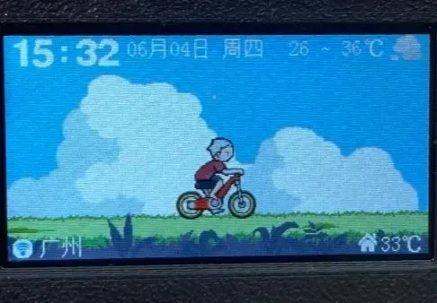
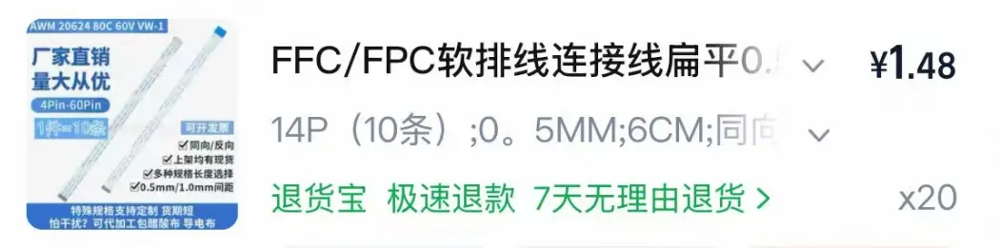

# 旅行天气时钟 ESP32-C3 2.0 · 硬件资料库

> 本仓库以**硬件**为主：完整整理一块 ESP32-C3 桌面天气时钟的双板结构、屏幕接口、发声与测温方案、板间连接和结构件，并说明它与 KairosTide 的借鉴关系。

## 项目地址

| 仓库 | 地址 | 内容 |
| --- | --- | --- |
| **本仓库（硬件资料 + Demo 介绍）** | https://github.com/jhlking/esp32c3-travel-weather-clock | 硬件拆解、BOM、接口、结构、装配与原创边界 |
| **KairosTide 完整项目（软件）** | https://github.com/yishengsss/KairosTide-NotimerDay.git | Vue 3 前端、FastAPI 后端、领域模型、契约与门禁等源码 |

被借鉴硬件项目：[旅行天气时钟-Esp32C3 2.0](https://oshwhub.com/eda_pnhleoqpu/esp32c3_-zhang-tiao-ping-you-hu-ji_copy_copy_copy_copy_copy)（eda_pnhleoqpu，GPL 3.0，仅供学习交流研究，不得商用）。

---

## 一、硬件总览

这是一块“主控板 + 显示板”的双 PCB 桌面设备：主控板负责 ESP32-C3、蜂鸣器、温度采集与外设，显示板承载 1.9 寸彩色 LCD；两块板通过 14P / 0.5 mm FPC 排线连接，外面套 3D 打印外壳，用 M2 平头自攻螺丝固定。

| 子系统 | 规格 / 方案 | 可信度 |
| --- | --- | --- |
| 主控 | ESP32-C3（工程名称与 ESP 系列标签） | 原工程页面确认 |
| 显示 | 1.9 寸 TFT，170×320 点阵，ST7789 驱动，4-SPI，10pin 插接 | 原工程描述 + 屏幕参数图 |
| 发声 | 3 个蜂鸣器（2.0 新增） | 原工程简介 + 实物图 |
| 测温 | 热敏电阻（2.0 去掉 IIC 温湿度模块） | 原工程简介 |
| 板间连接 | 14P、0.5 mm 间距 FPC 排线，配图规格 6 cm、同向 | 原工程描述 + 排线图 |
| 结构 | 3D 打印外壳；M2 平头自攻螺丝 | 原工程描述 + 实物图 |
| 供电 / 充电 | 原页面未公开 | 待原工程原理图确认 |
| 复刻成本 | 约 ￥30 | 原站标注 |
| 协议 | GPL 3.0 | 原站标注 |

```text
        ┌────────────── 显示板 ──────────────┐
        │  1.9" TFT LCD · ST7789 · 4-SPI     │
        │  10pin 排线插座                     │
        └──────────────┬─────────────────────┘
                       │ 14P / 0.5 mm FPC
        ┌──────────────┴─────────────────────┐
        │ 主控板：ESP32-C3                    │
        │ 蜂鸣器 ×3 · 热敏电阻 · 开关 / 接口   │
        └─────────────────────────────────────┘
                       │ M2 自攻螺丝
              3D 打印外壳（前壳 / 后壳）
```



## 二、显示板与 LCD 模块

屏幕是整套硬件里最直观的部分。原工程描述明确写的是“1.9 寸 LCD，10P 接口，分辨率 320×170”；配图中的同系列屏幕参数图给出了更细的规格。

| 参数 | 值 |
| --- | --- |
| 尺寸 / 分辨率 | 1.9 寸，170×320 点阵（竖屏使用） |
| 驱动 IC | ST7789 |
| 接口 | 4-SPI，10pin 插接版本 |
| 供电 | 3.3 V（以屏幕规格书为准） |
| 背光 | BLK 控制，需限流电阻（取值待原理图） |



**配图中的可读引脚名**（同一系列 8pin 模块版本）：`GND`、`VCC`、`SCL`、`SDA`、`RES`、`DC`、`CS`、`BLK`。这些是通用 SPI 屏信号，但本工程用的是 10pin 版本，多出的两脚用途无法从公开信息确认——可能是触摸、NC 或额外背光控制，**不可照搬 8pin 定义**。

显示板整体是一块带圆角与定位孔的绿色小 PCB，板上主要是 LCD 插座、少量阻容与 FPC 插座。屏幕通过软排线插接，拆装时注意金手指方向与插座 pin1。

## 三、主控板与外设

主控板承担计算、发声、测温与用户交互。从实物图能确认的布局包括：

- **ESP32-C3 主控**：工程名称与标签确定，具体模组封装需原理图确认。
- **蜂鸣器 ×3**：实物为并排的 3 个黑色圆形器件，位于板右侧；2.0 版本新增，配合自定义铃声与提示音。有源/无源型号与驱动电路不可从照片确认。
- **热敏电阻**：2.0 用热敏电阻替代原 IIC 温湿度模块，用于采集温度；阻值、B 值与分压电阻待确认。
- **电阻网络**：板上可见 R12～R23 等贴片电阻位号，推测为屏幕背光限流、蜂鸣器驱动与信号上拉/串联电阻，取值不可推断。
- **开关与连接器**：可见小型拨动开关、贴片连接器和白色插座，功能定义待原理图。
- **FPC 插座**：白色 14P / 0.5 mm 插座，用于连接显示板。



## 四、板间连接：14P / 0.5 mm FPC

两块 PCB 通过 FPC 排线连接，这是整套硬件最需要小心的地方：

| 项目 | 参数 |
| --- | --- |
| 引脚数 | 14P |
| 间距 | 0.5 mm |
| 排线长度 | 配图电商规格为 6 cm |
| 方向 | 配图标注“同向” |
| 连接对象 | 主控板 ↔ 显示板 |



装配要点：确认两端插座 pin1 对应、金手指朝向一致，锁扣完全扣合。0.5 mm 插座插反或不到位，轻则屏幕不亮，重则损坏屏幕或主控。完整 14P 信号定义原页面未公开，见 [PINOUT.md](docs/PINOUT.md) 的待核实模板。

## 五、结构与固定

外壳是 3D 打印件，带屏幕开窗、按键开窗与多处螺丝柱。原工程描述写明外壳螺丝使用 **M2 平头自攻螺丝**；配图电商截图显示规格为 M2×10、黑色杯头内六角平尾自攻，截图中的数量是购买数量，不是单机用量。


| 结构项 | 说明 |
| --- | --- |
| 外壳 | 3D 打印前壳 / 后壳；STL 未公开 |
| 螺丝 | M2 平头自攻（配图为 M2×10） |
| 开孔 | 屏幕开窗、按键孔、FPC 走线空间、螺丝柱 |
| 固定风险 | 螺丝过长或拧得过紧会顶伤 PCB 走线与元件 |

整机装配效果如下，屏幕显示时间、日期、温度区间、天气插画与城市信息：


## 六、BOM 与成本

原站 BOM 栏无公开数据，只能给出可核实部分与配图价格参考；完整清单见 [BOM.md](docs/BOM.md)。

| 物料 | 整机用量 | 备注 |
| --- | --- | --- |
| ESP32-C3 | 1 | 具体型号待原理图 |
| 1.9" TFT LCD（ST7789 / 10pin） | 1 | 30pin 版本不通用 |
| 蜂鸣器 | 3 | 2.0 新增 |
| 热敏电阻 | ≥1 | 替代 IIC 温湿度 |
| 14P / 0.5 mm / 6 cm FFC | 1 | 连接两块 PCB |
| M2 平头自攻螺丝 | 待确认 | 配图为 M2×10 |
| 3D 打印外壳 | 前壳 / 后壳各 1 | STL 未公开 |
| PCB | 主控板 + 显示板 | 层数、板厚、尺寸待确认 |

配图电商截图参考价：1.9" TFT 券后约 ￥6.3 起、M2×10 螺丝 ￥2.99/100 颗、14P FFC ￥1.48/条；原站标注整机复刻成本约 ￥30。

## 七、未公开与待核实项

原工程页面的“设计图 / BOM / 3D 模型 / 附件”在抓取时均无公开下载数据，以下信息无法从公开页面得到，切勿据此打板：

- [ ] 原理图、PCB 源文件与 Gerber
- [ ] 外壳 STL 与装配图
- [ ] 14P FPC 与 10pin LCD 的完整引脚定义
- [ ] 蜂鸣器驱动、热敏电阻分压与背光限流参数
- [ ] 电池 / 充电方案与 USB 接口定义
- [ ] 固件源码与烧录方式

获取方式：到原工程页面克隆 EDA 工程，或联系原作者。复刻前请自行验证电路可行性，后果自负。

## 八、KairosTide 与这套硬件的关系

KairosTide **只借鉴了这套硬件的三个思路**：桌面天气时钟的场景方向、天气数据进入画面、开源可复刻的精神；没有沿用其硬件、结构或固件。产品定义、交互、助手、场景渲染与软件架构都是本项目自己的二次开发与原创创作。

KairosTide 是一个弱化钟表的自然场景 Demo：首页不显示钟点与倒计时，长按约 600ms 才显示时间；事件进行中池塘出现当季生灵；助手以“待确认草稿”方式处理日程，不猜、不编造、图片不落库。完整项目源码见上方地址，借鉴与原创边界见 [KAIROSTIDE.md](docs/KAIROSTIDE.md)，本地最新版的后续更新见 [RECENT_UPDATES.md](docs/RECENT_UPDATES.md)。

## 九、文档索引

| 文档 | 内容 |
| --- | --- |
| [docs/HARDWARE.md](docs/HARDWARE.md) | 硬件详细说明：已确认参数与实物图可推断内容 |
| [docs/BOM.md](docs/BOM.md) | 可核实物料、参考价格与待补全项 |
| [docs/PINOUT.md](docs/PINOUT.md) | LCD 10pin 与板间 14P FPC 接口模板 |
| [docs/ASSEMBLY.md](docs/ASSEMBLY.md) | 打样、焊接、排线连接与外壳装配注意事项 |
| [docs/SOURCES.md](docs/SOURCES.md) | 每条硬件参数的来源与图片索引 |
| [docs/KAIROSTIDE.md](docs/KAIROSTIDE.md) | 借鉴与原创边界 |
| [docs/RECENT_UPDATES.md](docs/RECENT_UPDATES.md) | 最新版潮汐时钟的近期更新 |
| [hardware/](hardware/) | 原始 EDA 工程获取与目录约定 |

## 十、授权声明

- 被借鉴硬件项目作者 eda_pnhleoqpu，协议 GPL 3.0，知识产权归原作者；平台声明仅限学习交流研究，不得商用。
- 本仓库的图片与硬件参数均来自该项目公开页面，出处见 [SOURCES.md](docs/SOURCES.md)。
- KairosTide 的原创设计与实现归本项目作者；我们不宣称原作者的硬件、结构与固件为原创，也不把 KairosTide 描述为该项目的固件移植。
