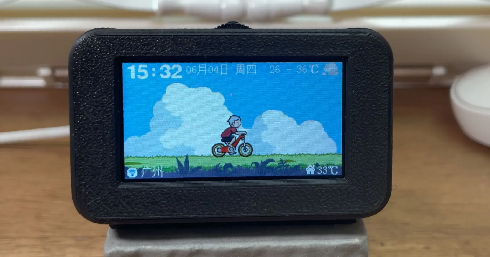

# KairosTide · 基于旅行天气时钟的二次开发

> 以立创开源硬件「旅行天气时钟 ESP32-C3 2.0」为硬件原型，重新设计时间表达。

## 一句话介绍

**KairosTide 不是原工程的复刻，而是一次面向产品体验的二次开发。**我们继承了原型「天气 + 时钟 + 桌面场景」的方向，把原创工作放在时间表达、交互方式与真实世界数据上：不再用倒计时压迫用户，而是让时间藏在太阳、天空、月亮、云、水面与物候里；想看时间就长按画面，想安排事情就直接开口问助手。

本仓库既完整记录原型硬件资料供复刻与对照，也明确划出我们的原创边界，避免把原作者的设计误认为我们的工作。

## 原创边界（先看这里）

| 原型提供的起点 | KairosTide 的原创设计 |
| --- | --- |
| ESP32-C3 + 彩色 LCD 的桌面天气时钟形态 | **田园四时场景**：由真实时间、地点、天气驱动的画面，平时不显示钟点、时间轴与剩余分钟 |
| 时间 / 日期 / 天气 / 温度的可视化展示 | **长按查时**：按住约 600ms 才在按压点显示真实时间，约 3 秒淡出，时间不常驻屏幕 |
| 蜂鸣器提示音、万年历等功能模块 | **物候生灵提醒**：事件进行中池塘出现当季当时当天气的动物，代替传统圆环与红点 |
| 硬件层面的“天气时钟”概念 | **对话助手 Kairos**：自然语言查日程、生成待确认草稿，依据逐字核对、不猜不编造、冲突由用户选 |
| 屏幕作为单一信息出口 | **柔性任务 + 图片导入**：抽空完成的事可单独管理；附图课表/通知由助手识别成可勾选草稿，图片不落库 |
| 单设备本地时钟 | **真实世界数据引擎**：真实亮星、月相与月距、流星雨历表、农历节气，与日程、天气统一进场景 |

完整说明见 [docs/KAIROSTIDE.md](docs/KAIROSTIDE.md)。

## 致谢与授权

- **原型作者**：eda_pnhleoqpu（立创开源硬件平台）
- **原型工程**：[旅行天气时钟-Esp32C3 2.0](https://oshwhub.com/eda_pnhleoqpu/esp32c3_-zhang-tiao-ping-you-hu-ji_copy_copy_copy_copy_copy) · [上游版本](https://oshwhub.com/eda_pnhleoqpu/esp32c3_-zhang-tiao-ping-you-hu-ji_copy_copy_copy)
- **原型协议**：GPL 3.0（全文见 [LICENSE](LICENSE)）；知识产权归原作者所有
- 原型平台声明：仅供学习交流及研究，不得用于商业售卖或盈利用途
- **KairosTide 的原创设计与实现**归本项目作者；我们只把原型作为起点，不宣称原作者的硬件、结构与固件为原创
- 资料抓取时间：2026-11-25，逐条出处见 [docs/SOURCES.md](docs/SOURCES.md)

## 硬件原型速览

| 项目 | 参数 | 依据 |
| --- | --- | --- |
| 主控 | ESP32-C3（工程名称 / ESP 系列标签） | 原型工程页面 |
| 显示屏 | 1.9 寸 TFT，320×170，ST7789 驱动，4-SPI，10P 接口 | 原型描述 + 屏幕截图 |
| 发声 | 3 个蜂鸣器（2.0 新增） | 原型简介 + 实物图 |
| 温度采集 | 热敏电阻（替代原 IIC 温湿度模块） | 原型简介 |
| 板间连接 | 两块 PCB，通过 14P / 0.5 mm FPC 排线连接 | 原型描述 + 排线截图 |
| 结构件 | 3D 打印外壳，M2 平头自攻螺丝固定 | 原型描述 + 实物图 |
| 设计工具 | 立创 EDA（OSHWHub 工程） | 平台属性 |
| 协议 / 成本 | GPL 3.0 / 约 ￥30 | 原型工程页面 |

详见 [docs/HARDWARE.md](docs/HARDWARE.md)。

## 原型界面实拍

屏幕顶部显示时间（如 `15:32`）、日期星期（`06月04日 周四`）、当日温度区间与天气图标；中间是天气插画；底部显示城市（如 `广州`）与温度。2.0 新增万年历模式。KairosTide 保留了“天气场景化”的方向，但把这种“信息常驻”的展示方式改成了“需要时才浮现”。更多见 [docs/FIRMWARE.md](docs/FIRMWARE.md)。

## 仓库导航

| 文档 | 内容 |
| --- | --- |
| [docs/KAIROSTIDE.md](docs/KAIROSTIDE.md) | **二次开发与原创设计说明**（必读） |
| [docs/HARDWARE.md](docs/HARDWARE.md) | 原型硬件架构、已确认参数与实物图可推断内容 |
| [docs/BOM.md](docs/BOM.md) | 原型可核实物料清单与待补全项 |
| [docs/PINOUT.md](docs/PINOUT.md) | 屏幕与板间接口（待原工程原理图确认） |
| [docs/FIRMWARE.md](docs/FIRMWARE.md) | 原型功能与界面特性 |
| [docs/ASSEMBLY.md](docs/ASSEMBLY.md) | 原型复刻装配注意事项 |
| [docs/SOURCES.md](docs/SOURCES.md) | 每条信息的来源与图片索引 |
| [hardware/](hardware/) | 原型 EDA 源文件获取与目录约定 |
| [assets/images/](assets/images/) | 原型页面配图（6 张） |

## 复刻提醒

1. 原站的“设计图 / BOM / 3D 模型 / 附件”在抓取时均无公开下载数据，需到原工程页面克隆工程或联系原作者才能得到完整 EDA 文件。
2. 接线与引脚定义请以原工程原理图为准；本仓库的引脚表是待核实模板，不可直接用于打板。
3. 自行验证电路可行性，复刻后果自负；不得用于商业售卖。
